<p align="center">
  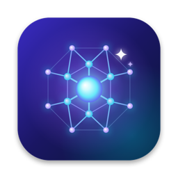
</p>

<h1 align="center">Lumen</h1>

<p align="center">
  A native SwiftUI chat app for your own AI models — on iPhone, iPad and Mac.<br>
  Connect to <b>Ollama</b> or any <b>OpenAI-compatible</b> server and chat with streaming replies.
</p>

<p align="center">
  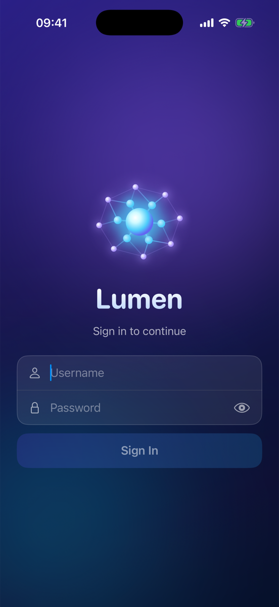
  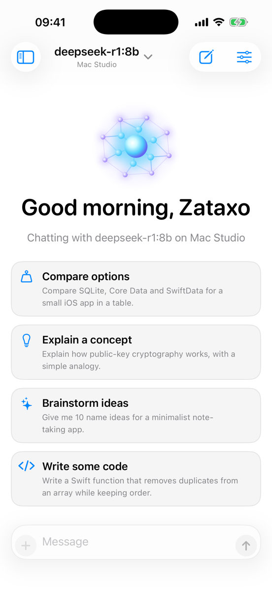
  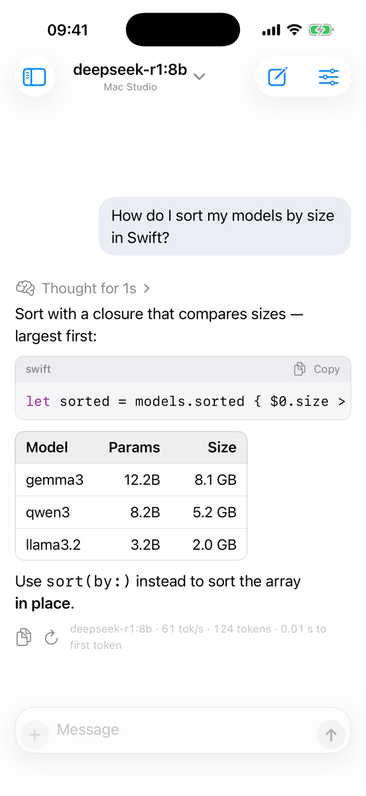
  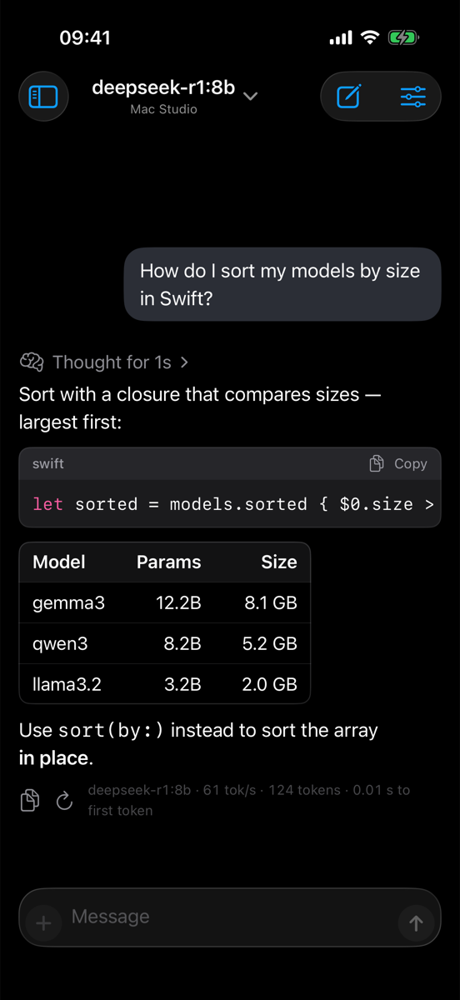
</p>

## Features

- **Your own servers** — add Ollama, LM Studio, llama.cpp, vLLM or any OpenAI-compatible endpoint by URL. API keys stay in the Keychain.
- **Streaming chat** — Markdown, syntax-highlighted code with copy, tables, stop, regenerate and edit-and-resend.
- **Reasoning models** — a collapsible “Thought for 4s” section for models that think.
- **Vision** — attach photos, files or pasted images for models that can see.
- **Model browser** — see sizes, quantization, context and capabilities; pull and delete Ollama models.
- **History** — search, pin, rename, delete and export chats (Markdown or JSON).
- **Made for each device** — sidebar on Mac and iPad, slide-over drawer on iPhone, ⌘K model switcher, light and dark themes.

<p align="center">
  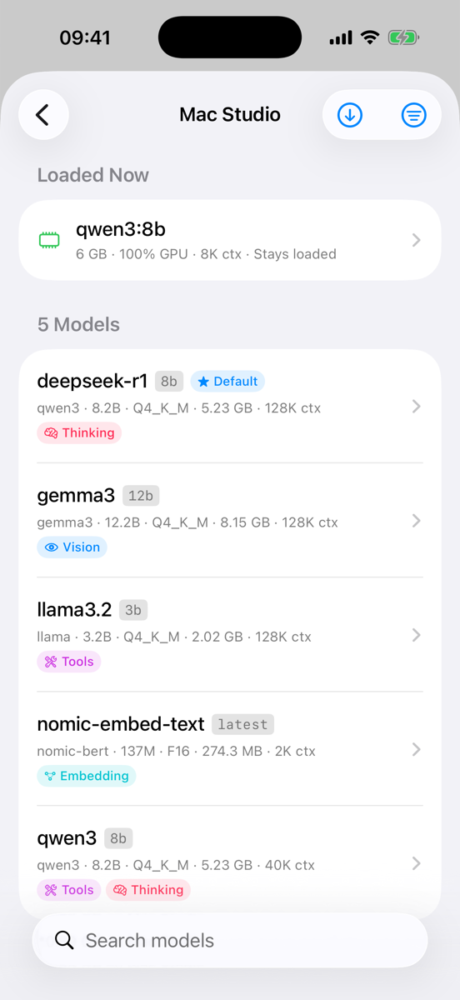
  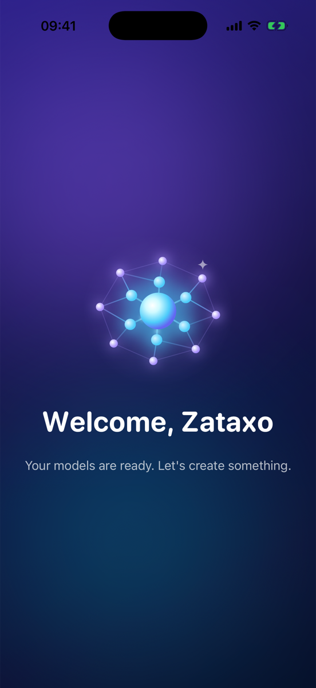
</p>

## On the Mac

<p align="center">
  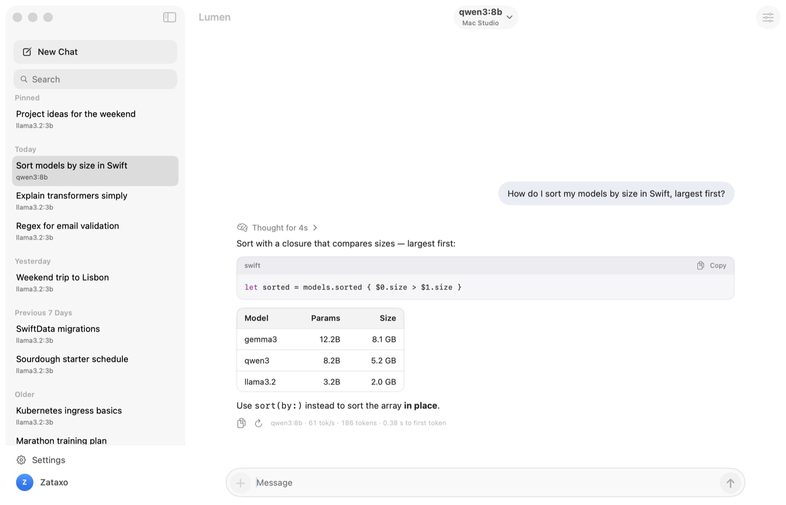
</p>

<p align="center">
  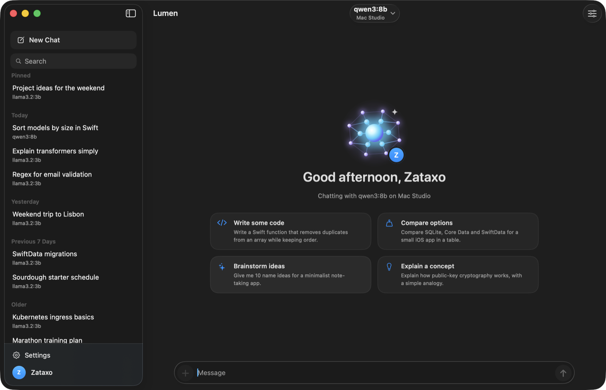
  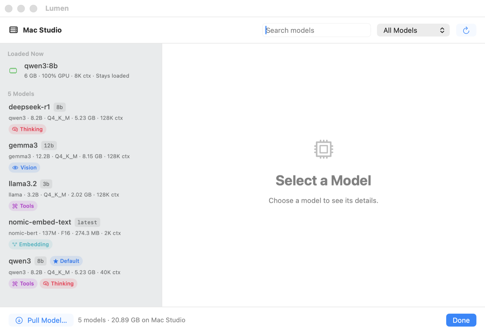
</p>

<p align="center">
  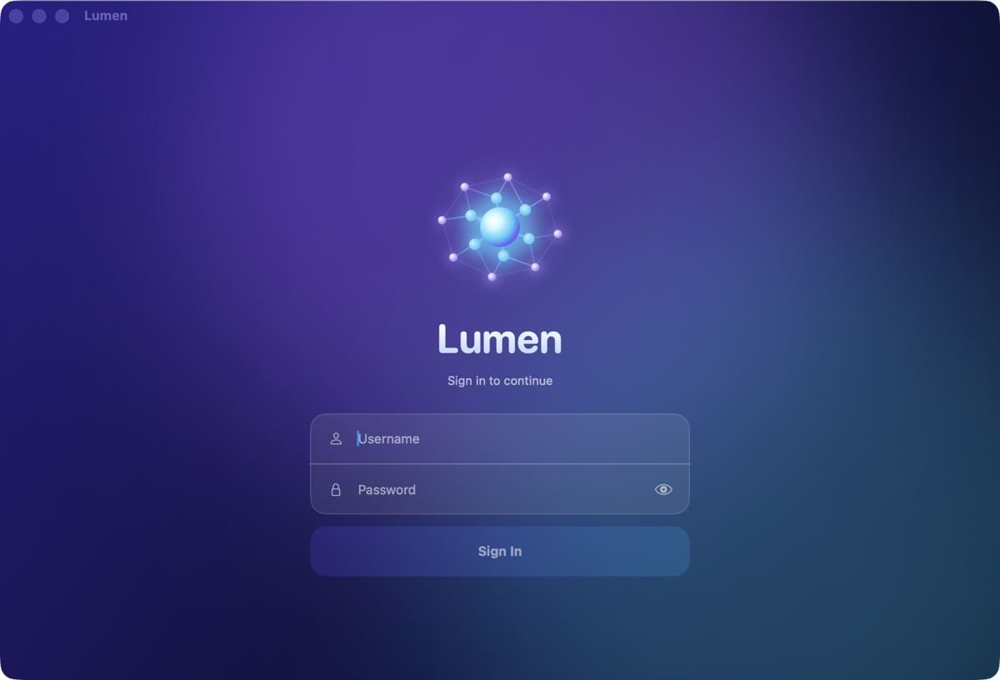
</p>

## Requirements

- Xcode 26 or later
- iOS / iPadOS 18+ or macOS 15+
- A running [Ollama](https://ollama.com) or OpenAI-compatible server

## Getting started

1. Open `llm.app.xcodeproj` in Xcode.
2. Choose the **Lumen** scheme and an iPhone simulator, iPad, or **My Mac**, then press **⌘R**.
3. Sign in with a demo account (below).
4. Add your server in **Settings → Servers** (for example `http://192.168.1.50:11434`), tap **Test Connection**, then start chatting.

> To reach Ollama from another device, start it with `OLLAMA_HOST=0.0.0.0 ollama serve`.

### Demo accounts

There is no backend yet, so sign-in uses two built-in accounts:

| Username | Password |
|----------|----------|
| Zataxo   | Admin123 |
| Zaad     | Admin123 |

This is a placeholder gate, not real security — replace `AuthStore` with a server call when a backend exists.

## Build from the command line

```bash
scripts/build-mac-app.sh --dmg      # native Mac app → build/Lumen.app, .zip and .dmg
scripts/build-unsigned-ipa.sh       # unsigned iOS app → build/Lumen-<version>-unsigned.ipa
```

The IPA must be signed before it can be installed. Run either script with `--help` for options.

## Tests

```bash
xcodebuild test -project llm.app.xcodeproj -scheme Lumen -destination 'platform=macOS'
```

## Project layout

```
llm/
├─ App/            app entry, sign-in, menus
├─ Providers/      Ollama + OpenAI-compatible clients and stream parsers
├─ Features/       Chat, Sidebar, Models, Settings, Profile, Auth
├─ Models/         SwiftData models
├─ DesignSystem/   Markdown renderer, animated orb, shared styles
└─ Utilities/      Keychain, export, image helpers
LumenTests/        unit tests
scripts/           build scripts
```

Built with SwiftUI, SwiftData and Swift 6. The only dependency is Apple's [swift-markdown](https://github.com/swiftlang/swift-markdown).
